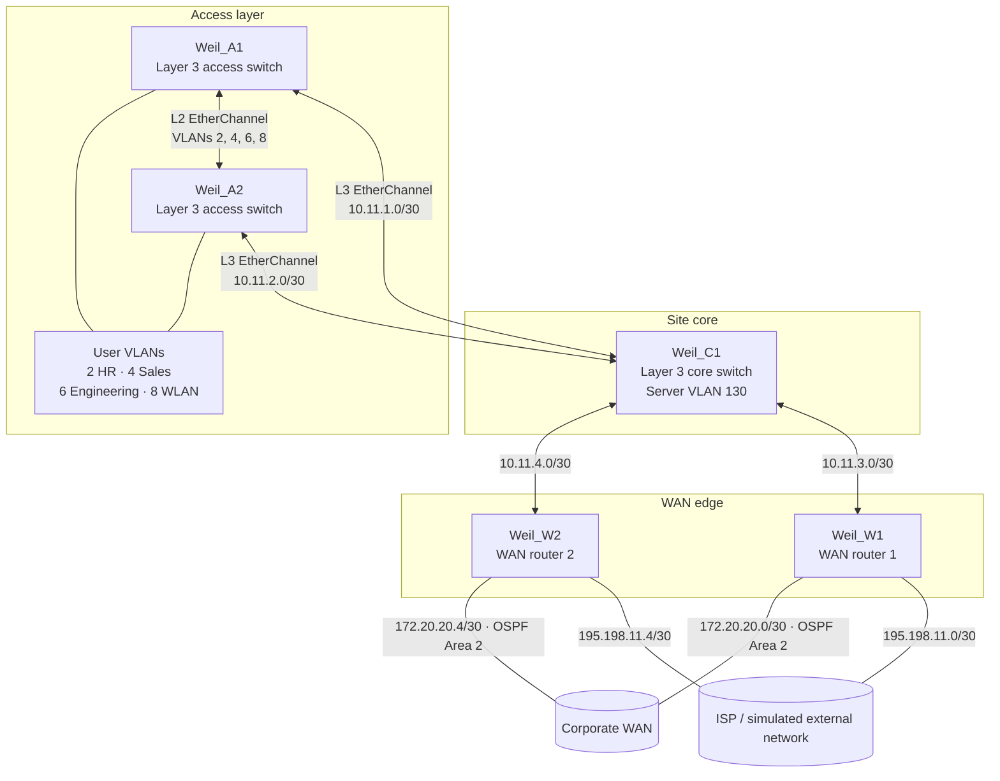

# Network Architecture – Weilburg Enterprise Network

## 1. Purpose and scope

The design represents a small enterprise site connected to a corporate WAN and an ISP through two WAN routers. The internal site uses two Layer 3 access switches and one Layer 3 core switch. The design combines segmented user networks, redundant default gateways, routed uplinks, dynamic routing and centralized services.

**Platform:** Cisco Packet Tracer  
**Devices:** Weil_A1, Weil_A2, Weil_C1, Weil_W1 and Weil_W2

## 2. Logical topology

The diagram is logical. Confirm physical port numbers and EtherChannel member assignments against the Packet Tracer file before using it as a cabling reference.

## 3. Device roles

| Device | Role | Primary responsibilities |
|---|---|---|
| Weil_A1 | Layer 3 access switch 1 | User VLAN SVIs, HSRP active for VLANs 2 and 4, preferred STP root, routed uplink to C1 |
| Weil_A2 | Layer 3 access switch 2 | User VLAN SVIs, HSRP active for VLANs 6 and 8, secondary STP root, routed uplink to C1 |
| Weil_C1 | Layer 3 core switch | Aggregates access switches, routes to WAN routers, provides Server VLAN 130 SVI |
| Weil_W1 | WAN router 1 | ISP and corporate WAN connectivity, OSPF, default route, NAT/PAT, Intranet ACL |
| Weil_W2 | WAN router 2 | Secondary ISP and corporate WAN connectivity, OSPF, default route, NAT/PAT, Intranet ACL |

## 4. Design principles

### Segmentation

Separate VLANs are used for HR, Sales, Engineering, WLAN and servers. The user VLANs are routed by the two access switches. Server devices use VLAN 130 at the core.

### Gateway redundancy and load sharing

HSRP provides a virtual default gateway for each user VLAN. The intended active-gateway distribution is split across the two access switches: A1 for VLANs 2 and 4, A2 for VLANs 6 and 8. The design also calls for preemption and tracking of the Layer 3 port-channel uplinks.

### Layer 2 and Layer 3 aggregation

An L2 EtherChannel carries the user VLANs between A1 and A2. Each access switch has an L3 EtherChannel uplink to C1. LACP is the required negotiation protocol.

### Spanning tree

Rapid PVST+ (802.1w) is required on the switches. A1 is intended as the primary root and A2 as the secondary root for the user VLANs. PortFast and BPDU Guard belong directly on end-device access interfaces.

### Routing domains

The Weilburg internal routing domain uses OSPF Area 0. The corporate-facing WAN links use Area 2, with W1 and W2 acting as ABRs. Both WAN routers have a next-hop default route towards their ISP and originate the default route into OSPF.

### Internet and Intranet policy

The WAN routers use PAT overload on their ISP-facing interfaces. A named standard ACL selects the internal VLAN networks for translation. The extended ACL named `intranet` allows HTTPS to `192.168.66.200`, denies HTTP to that server and permits other IP traffic.

## 5. Architecture references

- [IPv4 addressing plan](IP-Addressing-Plan.md)
- [Switching implementation](../02-Implementation/Switching-and-VLANs.md)
- [Routing and redundancy implementation](../02-Implementation/Routing-and-Redundancy.md)
- [Services and security implementation](../02-Implementation/Network-Services-and-Security.md)

## 6. Verification status

The design is documented separately from its operational proof. Refer to [Testing and Validation](../03-Testing-and-Validation/README.md) for observed tests and open validation items.
