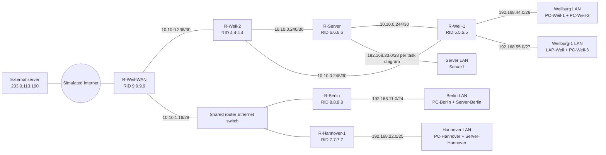

# WorldSkills Germany 2025 – Module C, Task 2: Network Troubleshooting

> **Status:** Troubleshooting completed in Cisco Packet Tracer. The operator reported that all PCs and servers could communicate with one another and reach the external server. The evidence files in this folder record the command outputs and tests captured during the investigation; they are not a substitute for a complete pair-by-pair test archive.

## 1. Project overview

This project documents the recovery of the prebuilt Weilburg multi-router network used in **WorldSkills Germany 2025 – IT Network Systems Administration (39), Module C – Networking, Task 2: Troubleshoot**.

The task scenario describes a simulated attack after which device configurations were changed or deleted. The supplied task says that the IP ranges shown in the topology remain valid, while some device addresses and configuration details must be discovered during troubleshooting.

**Primary objective:** restore IPv4 ICMP connectivity so that all PCs and servers can communicate with one another and reach the external server at `203.0.113.100`.

**Platform:** Cisco Packet Tracer  
**Technologies:** IPv4, Cisco IOS, Ethernet switching, VLANs, OSPFv2, standard and extended ACLs, interface negotiation, subnetting and ICMP verification.

This is an independent educational project. It is not affiliated with or endorsed by WorldSkills Germany. The original task PDF, starter Packet Tracer files and official topology artwork are not redistributed here. The logical topology below is recreated in Mermaid from the supplied diagram and observed interface information.

## 2. Network topology

The recovery topology consists of six routers:

- `R-Weil-WAN` – WAN edge and upstream/Internet connection.
- `R-Weil-2` and `R-Weil-1` – Weilburg routing devices.
- `R-Server` – server-LAN router.
- `R-Berlin` – Berlin LAN router.
- `R-Hannover-1` – Hannover LAN router.

The network has four serial `/30` routed links, a shared Ethernet transit segment (`10.10.1.16/29`), five LAN prefixes shown in the task diagram, and a simulated external server (`203.0.113.100`).

See 
) for the reconstructed logical diagram, verified serial endpoint mapping, router IDs and addressing notes.

## 3. Topology overview



## 4. Addressing plan

### LAN prefixes shown in the supplied topology

| LAN | Prefix shown in task diagram | Router / gateway address observed during the investigation |
|---|---:|---:|
| Berlin | `192.168.11.0/24` | R-Berlin Gi0/0/0: `192.168.11.1/24` |
| Hannover | `192.168.22.0/25` | R-Hannover-1 Gi0/0/0: `192.168.22.1/25` |
| Server LAN | `192.168.33.0/28` | See the Server-LAN addressing note in the topology document before treating a gateway address as final |
| Weilburg | `192.168.44.0/26` | R-Weil-1 Gi0/0/0: `192.168.44.1/26` |
| Weilburg-1 | `192.168.55.0/27` | R-Weil-1 Gi0/0/1: `192.168.55.1/27` after correction |

### Serial routed links – verified interface mapping

| Link | Router A interface / IP | Router B interface / IP | Prefix |
|---|---|---|---:|
| R-Weil-WAN ↔ R-Weil-2 | R-Weil-WAN Se0/1/0 – `10.10.0.237` | R-Weil-2 Se0/2/0 – `10.10.0.238` | `10.10.0.236/30` |
| R-Weil-2 ↔ R-Server | R-Weil-2 Se0/1/1 – `10.10.0.241` | R-Server Se0/1/1 – `10.10.0.242` | `10.10.0.240/30` |
| R-Server ↔ R-Weil-1 | R-Server Se0/1/0 – `10.10.0.245` | R-Weil-1 Se0/1/1 – `10.10.0.246` | `10.10.0.244/30` |
| R-Weil-2 ↔ R-Weil-1 | R-Weil-2 Se0/1/0 – `10.10.0.249` | R-Weil-1 Se0/1/0 – `10.10.0.250` | `10.10.0.248/30` |

The shared router Ethernet segment is `10.10.1.16/29`:

| Router | Interface | Address |
|---|---|---:|
| R-Weil-WAN | Gi0/0/0 | `10.10.1.17/29` |
| R-Berlin | Gi0/0/1 | `10.10.1.18/29` |
| R-Hannover-1 | Gi0/0/1 | `10.10.1.19/29` |

The observed upstream interface on R-Weil-WAN was Se0/1/1 with `192.0.2.113/29`; the simulated external server is `203.0.113.100`.

### End-host addresses confirmed in captured tests

| Host | Address / mask | Evidence status |
|---|---|---|
| PC-Hannover | `192.168.22.57/25` | Shown by `ipconfig` after correction |
| PC-Weil-1 | `192.168.44.20/26` | Used in successful host-to-host ping from PC-Hannover and in PC-Weil-1 verification |
| PC-Weil-3 | `192.168.55.26/27` | Shown in Packet Tracer IP Configuration and tested successfully |
| PC-Berlin | Not recorded in the captured output | Do not infer a host address from the LAN prefix |
| PC-Weil-2 | Not recorded in the captured output | Do not infer a host address from the LAN prefix |
| Server-Berlin, Server-Hannover, Server1, LAP-Weil | Not all host addresses recorded | Use the final Packet Tracer file for exact addresses |

**Server-LAN addressing review note:** the task diagram labels the Server LAN as `192.168.33.0/28`. An intermediate R-Server running-config capture showed Gi0/0/0 as `192.168.33.100/28`, which belongs to `192.168.33.96/28`, not `192.168.33.0/28`. The session later captured successful pings to `192.168.33.100`, but did not capture the final Server-LAN interface configuration after all repairs. For this reason, this README does not claim that `.33.100` is the final gateway for the diagram's `.33.0/28` prefix. Verify the saved Packet Tracer file before publishing a definitive Server-LAN gateway value.

## 5. OSPF design and verification

The restored routing domain used **OSPFv2 process 10, Area 0**. Router IDs recorded during the investigation:

| Router | Router ID |
|---|---:|
| R-Weil-2 | `4.4.4.4` |
| R-Weil-1 | `5.5.5.5` |
| R-Server | `6.6.6.6` |
| R-Hannover-1 | `7.7.7.7` |
| R-Berlin | `8.8.8.8` |
| R-Weil-WAN | `9.9.9.9` |

The investigation found and corrected missing OSPF network coverage, an incorrect interface-to-subnet mapping, a wrong shared-LAN IP address, a passive-interface setting on a router-to-router segment, and custom Hello/Dead timers that did not match the neighbor. Captured neighbor tables showed the relevant adjacencies reaching `FULL`.

### Shared Ethernet DR/BDR election

On the shared `10.10.1.16/29` broadcast segment, R-Weil-WAN used OSPF priority `255`. The observed election was:

| Router | Router ID | Observed role |
|---|---:|---|
| R-Weil-WAN | `9.9.9.9` | DR |
| R-Hannover-1 | `7.7.7.7` | BDR |
| R-Berlin | `8.8.8.8` | DROTHER |

The serial routed links were point-to-point and did not use a DR/BDR election.

Useful verification commands:

```cisco
show ip interface brief
show ip ospf neighbor
show ip ospf interface brief
show ip route ospf
show ip protocols
show running-config
```

## 6. Main troubleshooting findings

| Area | Confirmed issue | Corrective action / outcome |
|---|---|---|
| Endpoint power | Server-Berlin was powered off | Powered on the server |
| Switch uplink | S-Berlin Gi0/1 was administratively disabled | Enabled with `no shutdown` |
| Ethernet speed | S-Server Gi0/1 was set to 1000 Mbps while R-Server Gi0/0/0 was forced to 100 Mbps | Set R-Server Gi0/0/0 to `speed 1000`; Packet Tracer reported line protocol up |
| Duplex | R-Weil-1 Gi0/0/0 was configured `duplex half` | Changed to `duplex full`; Packet Tracer reported line protocol up |
| Switch uplink | S-Weil-1 Gi0/1 was administratively disabled | Enabled with `no shutdown` |
| Serial addressing | R-Weil-2 had the `.241` and `.249` addresses assigned to the wrong serial interfaces | Corrected Se0/1/0 to `.249` and Se0/1/1 to `.241`; OSPF neighbors to R-Weil-1 and R-Server reached `FULL` |
| OSPF network coverage | R-Server was missing the OSPF network statement for its R-Weil-1 serial subnet | Added `network 10.10.0.244 0.0.0.3 area 0`; R-Weil-1 adjacency reached `FULL` |
| OSPF network coverage / timers | R-Weil-WAN did not include `10.10.0.236/30`; custom Hello/Dead timers were set to 20/80 | Added the network statement and removed the custom timer overrides; R-Weil-2 adjacency reached `FULL` |
| Shared-LAN addressing | R-Hannover-1 Gi0/0/1 used `10.1.1.19/29` instead of `10.10.1.19/29` | Corrected the address; OSPF adjacency to R-Weil-WAN reached `FULL`; interface showed BDR |
| Berlin LAN addressing | R-Berlin LAN interface had an incorrect address | Corrected Gi0/0/0 to `192.168.11.1/24`; interface showed up/up |
| OSPF passive interface | R-Berlin Gi0/0/1 on the shared router segment was passive | Removed passive status from Gi0/0/1; adjacencies to R-Weil-WAN and R-Hannover reached `FULL` |
| ACL filtering | R-Hannover ACL 10 denied source traffic from `192.168.11.0/24` and was applied inbound on Gi0/0/1 | Removed the ACL binding from the interface; the ACL definition remained in the configuration |
| ACL filtering | R-Server ACL 100 contained `deny icmp any any` and was applied inbound on Gi0/0/0 | Removed ACL 100; `show access-lists` then returned no ACL entries |
| Hannover host addressing | PC-Hannover used `192.168.22.200/25`, outside the gateway's `192.168.22.0/25` subnet | Changed the PC to `192.168.22.57/25`, gateway `192.168.22.1`; gateway and external-server pings succeeded |
| Weilburg host/LAN configuration | Upper Weilburg PC address and gateway were initially incorrect; router LAN mask was `/27` although the diagram specifies `/26`; switch Fa0/1 was in VLAN 10 while the other relevant ports were in VLAN 1 | Corrected the PC to `192.168.44.20/26`, gateway `192.168.44.1`; corrected R-Weil-1 Gi0/0/0 to `/26`; moved Fa0/1 to access VLAN 1 and removed VLAN 10; gateway ping succeeded |
| Weilburg-1 gateway | R-Weil-1 Gi0/0/1 used `192.169.55.1/27` instead of `192.168.55.1/27` | Corrected the second octet; PC-Weil-3 successfully pinged its gateway and the external server |

The full chronological record, with commands and captured verification messages, is in [TROUBLESHOOTING-LOG.md](documentation/TROUBLESHOOTING-LOG.md).

## 7. Connectivity verification

Captured ping tests show successful IPv4 ICMP replies from PC-Berlin, PC-Hannover, PC-Weil-1, PC-Weil-3 and LAP-Weil to the destinations listed in [CONNECTIVITY-VERIFICATION.md](documentation/CONNECTIVITY-VERIFICATION.md). Every captured test in that table returned **4 replies out of 4 (0% packet loss)**.

The operator reported that all PCs and servers could communicate with one another and reach `203.0.113.100` after the repairs. Host-specific ping output for every server and PC-Weil-2 was not included in the captured session, so those individual tests are not represented as separately evidenced rows.

## 8. Troubleshooting workflow

The investigation followed a layered, evidence-led workflow:

1. Check device power, cabling and physical interface state.
2. Inspect interface state, speed, duplex and switchport/VLAN membership.
3. Validate IPv4 address, subnet mask and default gateway against the topology.
4. Verify point-to-point serial link addressing at both ends.
5. Inspect OSPF participation, area, timers, passive interfaces and neighbor state.
6. Check ACL rules and the interface/direction to which each ACL is applied.
7. Verify OSPF-learned routes and test ICMP hop by hop.
8. Change one item at a time, repeat the test and record the observed result.

## 9. Key lessons

- A link can be physically connected while its interface settings are still incompatible.
- Interface numbers must be mapped to actual cable endpoints before assigning addresses.
- `/25`, `/26` and `/27` subnet boundaries must be checked, not guessed.
- OSPF `FULL` adjacency confirms neighbor synchronization, but routes must still be checked in the routing table.
- `passive-interface` belongs on end-host LAN interfaces when no OSPF neighbor is expected; router-to-router segments must be allowed to exchange Hellos.
- Standard ACLs match source addresses; extended ACLs can match protocol, source, destination and ports. The interface and direction determine which packets are filtered.
- A successful ping to a router gateway is not by itself proof of full end-to-end host connectivity.

## 10. Repository contents

```text
Task-2-Network-Troubleshooting/
├── README.md
├── topology/
│   └── TOPOLOGY-AND-ADDRESSING.md
├── documentation/
│   ├── TROUBLESHOOTING-LOG.md
│   └── CONNECTIVITY-VERIFICATION.md
└── evidence/
    └── README.md
```

## 11. Source and redistribution note

- **Source task:** WorldSkills Germany 2025 – IT Network Systems Administration (39), Module C – Networking, Task 2: Troubleshoot, version 1.3 (18 May 2025).
- **Official task page/PDF:** [WorldSkills Germany – Module C task document](https://itnsa.de/static/WSG25_TP39_MC.pdf).
- The original PDF, competition starter `.pka` files, passwords, password hashes and official topology artwork are not reproduced in this repository.
- All IP addresses and device names in this write-up are lab topology details. No real production network information is intended to be represented.

---

**Project area:** Network Engineering · Enterprise Routing · Network Troubleshooting  
**Platform:** Cisco Packet Tracer  
**Routing protocol:** OSPFv2, process 10, Area 0
