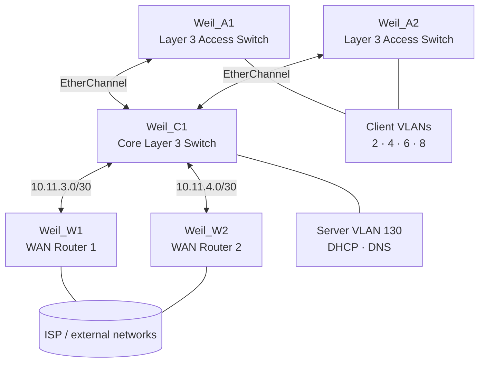

# Network Overview – Weilburg Enterprise Network

## Logical topology

This is a logical reference diagram, not a physical cabling map. Confirm interface numbers and EtherChannel member ports against the Packet Tracer topology.

## VLANs and HSRP gateways

| VLAN | Purpose | Prefix | Virtual gateway |
|---:|---|---:|---:|
| 2 | HR | `10.10.2.0/27` | `10.10.2.30` |
| 4 | Sales | `10.10.4.0/28` | `10.10.4.14` |
| 6 | Engineering | `10.10.6.0/26` | `10.10.6.62` |
| 8 | WLAN | `10.10.8.0/29` | `10.10.8.6` |
| 130 | Servers | `10.10.130.0/29` | Core SVI `10.10.130.6` |

## Infrastructure services

| Service | Address |
|---|---:|
| DHCP server | `10.10.130.2` |
| DNS server | `10.10.130.3` |
| Intranet server | `192.168.66.200` |
| Simulated external server | `200.1.1.100` (`www.google.de` in the observed DNS test) |

## Routed transit networks

| Link | Prefix |
|---|---:|
| Weil_A1 ↔ Weil_C1 | `10.11.1.0/30` |
| Weil_A2 ↔ Weil_C1 | `10.11.2.0/30` |
| Weil_C1 ↔ Weil_W1 | `10.11.3.0/30` |
| Weil_C1 ↔ Weil_W2 | `10.11.4.0/30` |
| Weil_W1 ↔ Corporate WAN | `172.20.20.0/30` |
| Weil_W2 ↔ Corporate WAN | `172.20.20.4/30` |
| Weil_W1 ↔ ISP | `195.198.11.0/30` |
| Weil_W2 ↔ ISP | `195.198.11.4/30` |

## Design verification checklist

- [ ] VLAN existence, access-port membership, trunk allowed VLANs, and native VLAN consistency.
- [ ] EtherChannel protocol, member consistency, and operational state.
- [ ] Rapid PVST+ mode and root placement for VLANs 2, 4, 6, and 8.
- [ ] HSRP group IDs, virtual IPs, active/standby distribution, preemption, priority, and uplink tracking.
- [ ] OSPF router IDs, areas, neighbor states, passive interfaces, and default-route propagation.
- [ ] DHCP relay on client VLAN SVIs; DHCP lease and DNS option verification on representative clients.
- [ ] NAT inside/outside placement, PAT translations, and end-to-end tests.
- [ ] SSH v2, local authentication, SSH-only VTY transport, and Server VLAN source ACL on required devices.
- [ ] Port-security MAC limits, violation mode, and correct AP interface on both access switches.
- [ ] Intranet ACL contents, interface direction, and HTTP/HTTPS behavior.
- [ ] Running configurations saved to startup configurations on all network devices.
